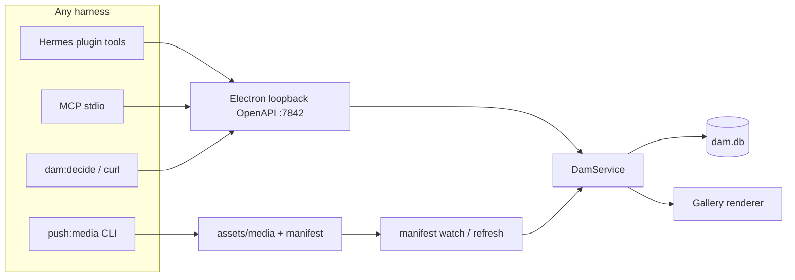
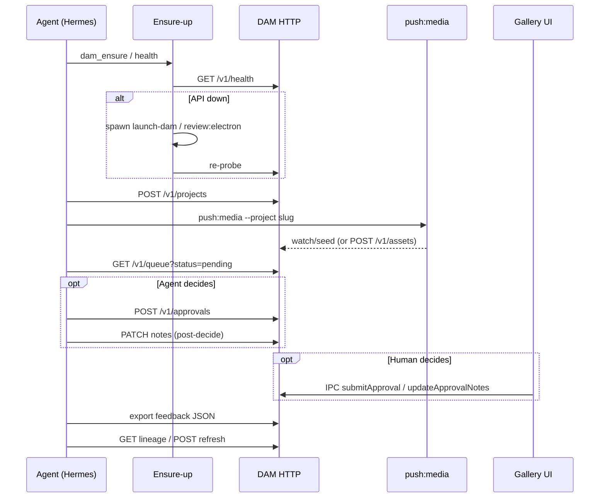

# feat: Hermes plugin for Electron DAM autonomous MVP

## Goal Capsule

- **Objective:** Any Hermes (or other harness) agent can run an unattended creative loop against MWT DAM—ensure Gallery is up, create a project section, push assets, list the pending queue, optionally submit love/keep/reject with notes (or leave decisions for human UI), read lineage, refresh, and export feedback—while Electron Gallery remains the central review viewpoint when a human looks.
- **Means:** Ship a native Hermes plugin that adapts the existing localhost OpenAPI contract (`127.0.0.1:7842`), close the few HTTP/adapter gaps needed for autonomous notes/export/ensure-up, and prove the loop with smoke/CI (KTD1–KTD4).
- **Authority:** Session-settled product constraints below → this plan's Product/Planning Contracts → `docs/AGENT-ELECTRON-SYNC.md` / `docs/HARNESS-CONNECTIVITY.md` / `docs/openapi-dam-api.yaml` for Phase 1 surfaces.
- **Stop when:** Definition of Done is met; do not expand into cloud tunnel, catalog admission, or a second review UI.
- **Execution profile:** Phased code delivery with smoke-first proof for packaging units and contract tests for HTTP gaps.
- **Who finishes:** Implementing agent (`ce-work` or human) on the active DAMMWT branch; Dave verifies live Gallery when UI is needed via `npm run review:electron` / `scripts/launch-dam.command`.

## Product Contract

### Summary

Turn Phase 1 DAM (HTTP + MCP + CLI + skills already implemented) into a first-class Hermes plugin and close remaining contract gaps so agents can complete an autonomous MVP run without Cursor-specific assumptions. Electron remains the sole SQLite writer and the human review surface.

### Problem Frame

Harness skills (`dammwt-harness`) already document curl/`dam:decide` against Electron's loopback API, but Hermes has no installable **plugin** with registered tools, bundled skills, ensure-up, and CI gates. Notes are editable after decide in the Gallery IPC path, yet agents cannot amend notes over HTTP. Without a packaged autonomous path, Hermes users cannot treat DAM as a durable creative review hub.

### Requirements

- R1. Agents can ensure DAM is reachable on the OpenAPI loopback base (default `http://127.0.0.1:7842`) before mutating work, with a clear failure when Electron cannot start or the API is disabled.
- R2. Agents can create/ensure a Gallery project section by slug (same disk/manifest contract as `dam:section`).
- R3. Agents can stage asset bytes primarily via `push:media` (or equivalent CLI/skill wrapper); optional one-shot `POST /v1/assets` remains available when Electron is up.
- R4. Agents can list the review queue filtered by status and project, including pending and decided rows needed for feedback export.
- R5. Agents can submit love/keep/reject (and changesRequested) with `reviewedBy` and optional notes via the universal HTTP contract; humans may instead decide in Gallery UI.
- R6. Notes remain editable after love/keep/reject for both Gallery UI and harness adapters (HTTP, MCP, `dam:decide`, Hermes tools).
- R7. Agents can read lineage (SoT chain + siblings) and trigger media refresh/reseed.
- R8. Agents can export feedback for a project (decisions + notes + lineage pointers) as structured JSON suitable for the next generation loop—without opening SQLite directly.
- R9. A Hermes-native plugin installs, enables, validates, and exposes tools that map 1:1 to the HTTP contract (plus ensure-up and export), remaining harness-agnostic at the wire level.
- R10. Smoke/CI proves API gap-closes and Hermes plugin validate/doctor; live Gallery review remains available via existing launch paths.
- R11. Electron owns SQLite while running; no second writer process.

### Actors

- A1. Autonomous agent (Hermes primary; Claude/Cursor/Grok/scripts consumers of the same HTTP contract)
- A2. Human reviewer (Dave) in MWT DAM Gallery
- A3. Electron main (DamService + SQLite + loopback API)
- A4. Bytes staging CLI (`push:media` / `dam:section`)

### Key Flows

- F1. Autonomous happy path
  - **Trigger:** Agent starts a generative review job for project slug `P`.
  - **Actors:** A1, A3, A4 (A2 optional)
  - **Steps:** ensure-up → create section → generate externally → push bytes → list pending → (optional) decide + notes **or** wait for A2 in Gallery → export feedback → lineage for next gen → refresh as needed.
  - **Covered by:** R1–R11
- F2. Human-in-the-loop review
  - **Trigger:** Agent pushed assets and leaves decisions to Gallery.
  - **Actors:** A1, A2, A3
  - **Steps:** Agent lists pending; A2 love/keep/reject + notes in UI; agent re-lists / exports feedback; agent may amend notes after decide via HTTP (R6).
  - **Covered by:** R4–R6, R8

### Acceptance Examples

- AE1. Covers F1 / R1–R5, R9. Given Electron can start on the machine, when a Hermes agent with the plugin enabled runs the autonomous loop for a new slug with one staged PNG, then health is ok, the project appears under Gallery Projects, the asset is pending (or decided if the agent submitted), and export JSON includes that asset's status/notes.
- AE2. Covers F2 / R6. Given an asset already loved with notes `"hero"`, when the agent updates notes to `"hero — warmer grade"` without changing status, then queue/history reflects the new notes and Gallery shows them after `media:updated`.
- AE3. Covers R9–R10. Given the plugin directory in-repo, when `hermes plugins validate` and `hermes plugins doctor --ci` run against it, then both exit 0; `npm run verify:api` still passes including notes + export coverage.

### Success Criteria

- Hermes can install/enable the DAM plugin and call tools for health, section, queue, decide, notes, lineage, refresh, ensure-up, and export.
- Unattended loop F1 completes without Cursor MCP being required.
- Gallery remains the human review UI; agents do not become a second gallery.
- Phase 1 docs stay authoritative for the wire contract; plugin is an adapter.

### Scope Boundaries

#### In scope

- HTTP/OpenAPI/MCP/`dam:decide` gap-closes for post-decide notes and feedback export.
- Ensure-up helper (health probe + launch guidance / best-effort start via existing launch scripts).
- Native Hermes plugin package under the DAMMWT repo (tools + bundled skills + install docs).
- Smoke scripts and CI hooks for validate/doctor + API acceptance.
- Doc sync so Hermes/agents skills point at the plugin without forking the HTTP contract.

#### Deferred to Follow-Up Work

- Hermes plugin-catalog PR / official catalog pin (local `hermes plugins validate` already matches the admission gate).
- Cloud tunnel or multi-device sync (Phase 2 in `docs/AGENT-ELECTRON-SYNC.md`).
- Multipart HTTP upload replacing `push:media` as primary bytes path.
- Portable Agent Plugins v1 dual package (root `plugin.json` skills+MCP adapter) — separate follow-up if multi-harness single-folder distribution is required (see KTD1).

#### Non-goals

- Second SQLite writer or headless DamService as a long-running alternative to Electron for MVP.
- Replacing Gallery with a Hermes-native review UI.
- LAN bind (`0.0.0.0`) or multi-tenant auth.
- Relying on `./.hermes/plugins/` project-local discovery for session tools (gateway does not load it).
- Reopening session-settled product decisions below.

### Key Decisions (product)

- KD1. HTTP OpenAPI on loopback `:7842` remains the universal contract; MCP/CLI/Hermes tools are adapters only. `(session-settled: user-directed — chosen over MCP-or-CLI-as-primary: one wire contract for every harness)` · Governs R1, R5, R9, R11
- KD2. Electron owns SQLite while running; no second writer. `(session-settled: user-directed — chosen over headless DB service: Gallery + API share one DamService)` · Governs R11
- KD3. `push:media` remains primary for bytes. `(session-settled: user-directed — chosen over HTTP-multipart-first: disk SoT + existing CLI stay durable)` · Governs R3
- KD4. Harness-agnostic adapters (Claude/Cursor/Grok/Hermes/any). `(session-settled: user-directed — chosen over Hermes-only protocol: Hermes plugin is packaging, not a private API)` · Governs R9
- KD5. Notes editable after love/keep/reject. `(session-settled: user-directed — chosen over notes-frozen-on-decide: steering continues after status)` · Governs R6

### Dependencies

- Phase 1 API already implemented (`src/api/localServer.ts`, `src/api/DamService.ts`, `mcp/`, `scripts/dam-decide.mjs`, `docs/openapi-dam-api.yaml`).
- Launch paths: `npm run review:electron`, `scripts/launch-dam.command`, optional Desktop `MWT DAM.app`.
- Local Hermes CLI with `hermes plugins validate|doctor|install|enable` (install identifiers: catalog name, Git URL / `owner/repo[/subdir]`, or `file://` local URL — not a bare relative filesystem path).
- Env contract in `docs/DAM-HARNESS.md` (`DAMMWT_ROOT`, `DAM_API_BASE`, `DAM_API_TOKEN` / `DAM_API_TOKEN_FILE`).

### Outstanding Questions

- None blocking. Deferred: exact ensure-up UX when no display session exists (record as Assumption A3).

### Sources

- `docs/AGENT-ELECTRON-SYNC.md`, `docs/HARNESS-CONNECTIVITY.md`, `docs/DAM-HARNESS.md`, `docs/openapi-dam-api.yaml`
- Existing skills: `.cursor/skills/dammwt-harness/`, mirrors under `~/.agents/skills/` and `~/.hermes/skills/`
- Official Hermes plugins guide: https://hermes-agent.nousresearch.com/docs/developer-guide/plugins (local mirror `~/.hermes/hermes-agent/website/docs/developer-guide/plugins/index.md`; user-facing `…/user-guide/features/plugins.md`; catalog admission `…/plugins/catalog-submission.md`)
- Local Hermes CLI probed this deepen: **v0.22.5** (`hermes plugins validate|doctor|install|enable`)
- Peer notes: Phase 1 MCP/`dam:decide` delivered; agent-electron-sync architecture locked

## Planning Contract

### Key Technical Decisions

- KTD1. Ship a **native** Hermes plugin (`plugin.yaml` + `__init__.py` `register(ctx)` + `schemas.py`/`tools.py` + bundled skills via `ctx.register_skill`). Do **not** ship a root portable Agent Plugins v1 `plugin.json` as the package. `(rationale: native is the only path for first-class dam_* tools, ensure-up, optional CLI/slash hooks; portable `plugin.json` is skills+MCP-only and does not replace native. Official validate rule: when both manifests exist, **native `plugin.yaml` always wins**; portable validation applies only to `plugin.json`-only trees. Still omit root `plugin.json` so the package is unambiguously native and CI does not exercise the wrong admission path. Portable dual-package remains Deferred.)`
- KTD2. Close the **notes-after-decide** gap on the universal contract first: expose `DamService.updateApprovalNotes` as `PATCH /v1/assets/:assetId/notes`, then OpenAPI + MCP + `dam:decide`, then Hermes tools. `(session-settled product KD5 · Governs R6)`
- KTD3. **Feedback export** is a thin read aggregator over existing queue/history/lineage routes (project-scoped JSON), not a new persistence model or SQLite dump. `(chosen over raw DB export: preserves no-second-writer rule)`
- KTD4. **Ensure-up** probes `GET /v1/health`; on connection refused, best-effort spawn existing launch script (`review:electron` / `launch-dam.command`) in the background and re-probe with timeout; never open `dam.db` from the plugin. Run ensure/HTTP only inside **tool handlers**, never during `register(ctx)` — Plugin Doctor blocks sockets at registration. `(chosen over embedding DamService in Hermes: KD2 / R11)`
- KTD5. Keep plugin **source** in-repo under `hermes-plugin/dammwt/` as a standalone directory (third-party product plugins stay out of `NousResearch/hermes-agent` core). Install into the **user** plugins tree for sessions: `hermes plugins install file://$PWD/hermes-plugin/dammwt` (local clone warning), or `owner/repo/hermes-plugin/dammwt` from Git, or copy/symlink into `~/.hermes/plugins/dammwt/`, then `hermes plugins enable dammwt`. Do **not** rely on `./.hermes/plugins/` — gateway sessions do not load project-local plugins. Catalog submission deferred.

### Assumptions

- A1. Phase 1 HTTP surface listed in OpenAPI is present on the active branch (health, projects, assets, queue, approvals, lineage, shell, refresh). PRs #8/#9 could not be re-fetched (`gh` auth invalid); docs + source are the evidence base.
- A2. Headless scoping confirmed automatically (pipeline): inferred that “export feedback” means structured JSON of decided/pending rows + notes for steering, not a Notion/Drive upload.
- A3. Ensure-up on CI agents without a GUI may only assert clear errors + document manual launch; interactive Mac review machines get best-effort auto-launch.
- A4. Existing `~/.hermes/skills/dammwt-harness` remains valid; the plugin bundles/registers the canonical skill copy via `ctx.register_skill` rather than deleting personal mirrors overnight.
- A5. Hermes CLI on review machines is ≥ the docs baseline used for this deepen (v0.22.5 locally); `hermes plugins validate` / `doctor --ci` match the guide's catalog/CI gates.
- A6. Plugin skills registered with `ctx.register_skill` are **not** auto-listed in the system prompt `<available_skills>` index (official guide) — agents load them via `skill_view("dammwt:<skill>")`. Autonomously runnable loop must be complete through **tools** alone; bundled skills are recipes/context, not the only entrypoint.

### High-Level Technical Design

#### Component map



#### Autonomous sequence



#### Packaging layout (Output Structure)

Align with the official native layout (manifest + register + schemas + tools), plus DAM-specific HTTP helpers:

```text
hermes-plugin/dammwt/
├── plugin.yaml          # name/version/provides_tools/requires_env[/config_schema]
├── __init__.py          # register(ctx): tools + ctx.register_skill loops
├── schemas.py           # LLM-facing tool schemas (official Step 3)
├── tools.py             # handlers → HTTP (JSON string returns; never raise)
├── http_client.py       # bearer + DAM_API_BASE helpers (used by handlers only)
├── ensure.py            # health + launch best-effort (handlers only; not at register)
├── skills/
│   ├── dammwt-harness/SKILL.md
│   └── dammwt-push-media/SKILL.md   # or thin pointer + scripts
├── README.md            # install/enable/validate/doctor (user plugins path)
└── tests/               # optional; prefer hermes doctor --ci as primary gate
```

No root portable `plugin.json`. Optional empty `pyproject.toml` only if Python deps are declared; otherwise declare none (stdlib + urllib preferred for MVP HTTP).

#### Official install / validate / doctor recipe (MVP)

```bash
# From DAMMWT checkout — validate tree without installing
hermes plugins validate hermes-plugin/dammwt
hermes plugins validate hermes-plugin/dammwt --install-deps   # catalog-CI parity when deps exist
hermes plugins doctor hermes-plugin/dammwt --ci

# Install into ~/.hermes/plugins/ (sessions do not load ./ .hermes/plugins/)
hermes plugins install "file://$PWD/hermes-plugin/dammwt" --no-enable
# or: hermes plugins install "file://$PWD/hermes-plugin/dammwt" --enable --yes-deps
hermes plugins enable dammwt   # name from plugin.yaml; opt-in allow-list
```

`provides_tools` must list every tool `register()` registers — `hermes plugins validate` fails on declared/registered drift (catalog admission gate).

### System-Wide Impact

| Surface | Impact |
|---------|--------|
| Electron main / DamService | New HTTP read/write routes for notes + export; same SQLite writer |
| Gallery renderer | Continues IPC; must stay consistent with HTTP notes via shared DamService + `media:updated` |
| MCP + `dam:decide` | Tool/CLI parity with HTTP (no divergent semantics) |
| Hermes sessions | New optional tools/skills after plugin enable; other harnesses unchanged if they keep using HTTP |
| CI | Extra validate/doctor and API assertions; GUI launch not required in upstream CI |
| Human reviewer | Still decides in Gallery when agents leave pending; agents must not replace Gallery |

Agent/human boundary: submitting decisions is allowed for automation (R5) but default autonomous recipe may leave pending for Dave; notes amend and export never require UI.

### Implementation Constraints

- Bind remains `127.0.0.1` only; bearer auth on all mutating routes.
- Plugin tools must not import Electron internals or open SQLite.
- Bytes staging stays CLI-primary (KD3).
- After Electron/API UI-affecting changes, relaunch via `npm run review:electron` for human review (workspace rule).

### Research Summary

- Phase 1 is implemented; Hermes today has a **skill**, not a **plugin**.
- Critical gap for KD5/R6: `updateApprovalNotes` exists in `DamService` / IPC / Gallery but is absent from `localServer.ts`, OpenAPI, MCP, and `dam:decide`.
- Official plugins guide (2026 deepen): native `plugin.yaml` + `register(ctx)` is the path for tools; portable Agent Plugins v1 is a compatibility adapter for skills + MCP only; when both manifests exist native wins; project-local plugins are not session-loaded; plugins are opt-in (`plugins.enabled`); validate/doctor are the CI gates.
- External research shaped/refined KTD1 and KTD5 (native packaging + user-plugins install path). See **Research notes — Hermes plugins guide** below.

### Execution Order

1. U1 HTTP notes + OpenAPI  
2. U2 MCP + `dam:decide` notes parity  
3. U3 Feedback export route + CLI  
4. U4 Ensure-up helper (shared script usable by plugin + skills)  
5. U5 Native Hermes plugin package  
6. U6 Autonomous loop recipe + smoke script  
7. U7 CI gates  
8. U8 Docs/skills sync + MVP checklist

## Implementation Units

### Unit Index

| ID | Name | Depends on |
|----|------|------------|
| U1 | HTTP notes-after-decide | — |
| U2 | MCP + dam:decide notes parity | U1 |
| U3 | Feedback export | U1 |
| U4 | Ensure-up helper | — |
| U5 | Native Hermes plugin | U1–U4 |
| U6 | Autonomous loop smoke | U3–U5 |
| U7 | CI validate/doctor + API | U1, U5, U6 |
| U8 | Docs and skill sync | U5–U7 |

### U1. HTTP notes-after-decide

- **Goal:** Expose post-decide notes edits on the universal HTTP contract.
- **Requirements:** R6, KD5, KTD2
- **Dependencies:** none (DamService already implements `updateApprovalNotes`)
- **Files:** `src/api/localServer.ts`, `docs/openapi-dam-api.yaml`, `scripts/verify-dam-api.ts` (or sibling test), `src/api/DamService.ts` (only if emit/broadcast needs touch-up)
- **Approach:**
  1. Add authenticated `PATCH /v1/assets/:assetId/notes` with body `{ "notes": string, "reviewedBy"?: string }` calling `service.updateApprovalNotes` (do not add a parallel `POST /v1/approvals/notes` alias in MVP).
  2. Broadcast the same media/queue update path used by approvals so Gallery refreshes.
  3. Document request/response in OpenAPI; extend `verify:api` with love-then-amend-notes assertion.
- **Patterns to follow:** Existing `POST /v1/approvals` error shape `{ ok, error }`; IPC `updateApprovalNotes` input type.
- **Test scenarios:**
  - Happy path: after love with notes `"a"`, PATCH notes to `"b"` → history latest notes `"b"`, status remains love.
  - Edge: empty notes string clears or stores empty per existing DB semantics (match IPC).
  - Error: unknown assetId → 4xx; missing bearer → 401.
  - Integration: mutating notes emits refresh so open Gallery would see update (assert service emit/broadcast hook if testable headlessly).
- **Verification:** `npm run verify:api` includes notes-after-decide; OpenAPI lists the operation.

### U2. MCP + dam:decide notes parity

- **Goal:** Adapters expose the same notes capability as HTTP.
- **Requirements:** R6, R9, KD1, KD4
- **Dependencies:** U1
- **Files:** `mcp/index.mjs`, `mcp/README.md`, `scripts/dam-decide.mjs`, `mcp/client.mjs` (if needed)
- **Approach:**
  1. Add MCP tool `dam_update_notes` → new HTTP route.
  2. Add `dam:decide notes --asset-id … --notes …` (or `submit --notes-only` if cleaner—prefer explicit `notes` subcommand).
- **Execution note:** Characterization against live route shapes; keep MCP thin (no business logic).
- **Test scenarios:**
  - Happy: MCP tools/list includes `dam_update_notes`; tools/call updates notes.
  - Happy: `dam:decide notes` round-trips against verify harness or documented smoke.
  - Error: API down → clear unreachable message (existing pattern).
- **Verification:** README tool table updated; manual/automated smoke covers the new tool.

### U3. Feedback export

- **Goal:** Agents can export project feedback as structured JSON without SQLite access.
- **Requirements:** R4, R8, KTD3
- **Dependencies:** U1 (notes must appear in export)
- **Files:** `src/api/localServer.ts`, `src/api/DamService.ts` (aggregator helper), `docs/openapi-dam-api.yaml`, `scripts/dam-decide.mjs`, `scripts/verify-dam-api.ts`
- **Approach:**
  1. Add `GET /v1/projects/:slug/feedback` (or `GET /v1/feedback?project=`) returning assets with status, notes, reviewedBy, reviewedAt, and optional lineage summary pointers.
  2. Implement as read-only DamService method composing queue/history—no new tables.
  3. Wire `dam:decide export --project <slug>`.
- **Test scenarios:**
  - Happy: project with pending + loved rows exports both with correct fields.
  - Edge: unknown project → empty list or 404 (pick one and document).
  - Error: unauthenticated → 401.
- **Verification:** OpenAPI + verify:api cover export; CLI prints JSON.

### U4. Ensure-up helper

- **Goal:** Shared ensure-up for skills/plugin/CLI: probe health, optionally launch DAM, re-probe.
- **Requirements:** R1, KTD4, R11
- **Dependencies:** none
- **Files:** `scripts/dam-ensure.mjs` (new), `package.json` script `dam:ensure`, optionally thin shell wrapper under skill scripts
- **Approach:**
  1. `GET /v1/health` with short timeout.
  2. On refusal: spawn `npm run review:electron` or `scripts/launch-dam.command` detached from `DAMMWT_ROOT`; poll health until timeout.
  3. Never touch `dam.db`; honor `DAM_API_DISABLE` as hard fail with message.
- **Execution note:** Prefer runtime smoke over heavy unit mocks; GUI-less CI asserts failure messaging.
- **Test scenarios:**
  - Happy: API already up → ok immediately with pid/stats.
  - Error: disable flag / unreachable after timeout → non-zero exit + actionable message naming launch paths.
  - Edge: token file missing does not block health (health is unauthenticated).
- **Verification:** `npm run dam:ensure` documented; used by U5/U6.

### U5. Native Hermes plugin

- **Goal:** Installable Hermes plugin registering dam_* tools and bundling skills per the official native contract.
- **Requirements:** R9, R1–R8, KTD1, KTD5, KD4 · A6
- **Dependencies:** U1–U4
- **Files:** `hermes-plugin/dammwt/**` (new tree per Output Structure), skill markdown copies, plugin README
- **Approach:**
  1. Author `plugin.yaml`: `name: dammwt` (or `dammwt-dam`), `version`, `description`, exact `provides_tools` list matching every `ctx.register_tool` name, rich `requires_env` for `DAMMWT_ROOT` / `DAM_API_TOKEN` (or `DAM_API_TOKEN_FILE` documented as optional if health-only tools allow), optional `config_schema` for `api_base` defaulting to `http://127.0.0.1:7842`. Prefer **v1** manifest (omit `manifest_version`) unless a v2 field is needed; do not declare `capabilities:` unless a privileged surface is truly required (HTTP adapters need none).
  2. Split `schemas.py` (LLM schemas) and `tools.py` (handlers). Handler contract from the guide: `(args: dict, **kwargs) -> str` JSON; catch all exceptions; never raise into Hermes.
  3. `register(ctx)` wires schemas→handlers with a stable `toolset` (e.g. `dammwt`); register tools mirroring MCP names plus `dam_ensure` and `dam_export_feedback`. **No HTTP, no sockets, no ensure-up during `register()`** (doctor blocks sockets).
  4. Bundle skills with `ctx.register_skill(child.name, skill_md)` over `skills/*/SKILL.md` — namespaced as `dammwt:<skill>`; do not `shutil.copy2` into `~/.hermes/skills/`.
  5. README: validate/doctor commands; install via `file://` or Git `owner/repo/hermes-plugin/dammwt`; then `hermes plugins enable <name>`; note plugins are disabled until enabled; note project-local `./.hermes/plugins/` is not session-loaded.
- **Execution note:** Packaging-first; primary proof is `hermes plugins validate` and `hermes plugins doctor … --ci`, not deep Python unit tests. Prefer stdlib HTTP client so CI need not `--install-deps`.
- **Test scenarios:**
  - Happy: `hermes plugins validate hermes-plugin/dammwt` exits 0; declared tools match registered.
  - Happy: `hermes plugins doctor hermes-plugin/dammwt --ci` exits 0 (register succeeds with no network).
  - Happy: after install+enable, `/plugins` or `hermes plugins list` shows dammwt tools; `provides_tools` names appear.
  - Error: missing token / unreachable API from a **tool call** returns structured JSON error (no traceback dump).
  - Integration: tool `dam_list_queue` against a running API matches curl (AE3 / R9).
  - Edge: plugin directory without root `plugin.json`; validate still green as native-only.
- **Verification:** README install path works on this machine; validate+doctor green; no portable root `plugin.json`.

### U6. Autonomous loop smoke

- **Goal:** One scripted unattended path proving F1 end-to-end on a Mac with DAM.
- **Requirements:** R1–R10, AE1
- **Dependencies:** U3, U4, U5
- **Files:** `scripts/dam-autonomous-smoke.sh` (or `.mjs`), fixture under `assets/media/projects/` ephemeral slug, docs snippet
- **Approach:**
  1. Sequence: ensure → create section → push fixture file → list pending → optional decide + notes amend → export → lineage → refresh.
  2. Use unique slug per run; clean up or mark harness-smoke partition.
  3. Exit non-zero on any step failure with step name.
- **Test scenarios:**
  - Happy: full script green with Electron up.
  - Error: Electron down and ensure timeout → fails at ensure with message.
  - Edge: decide skipped mode still exports pending rows.
- **Verification:** Documented command in README / HARNESS-CONNECTIVITY; AE1 satisfied manually once.

### U7. CI gates

- **Goal:** Non-GUI CI covers API gaps; Hermes validate/doctor runs where Hermes is available (same checks catalog CI uses).
- **Requirements:** R10, AE3
- **Dependencies:** U1, U5, U6
- **Files:** `.github/workflows/ci-node.yml` (or dedicated workflow), `package.json` scripts, optional `scripts/ci-hermes-plugin.sh`
- **Approach:**
  1. Ensure `verify:api` (notes + export) stays in default `npm run verify` / CI node job.
  2. Add job or step when `hermes` is present: `hermes plugins validate hermes-plugin/dammwt` (add `--install-deps` only if the plugin declares Python deps) and `hermes plugins doctor hermes-plugin/dammwt --ci`. Prefer `--json` on validate for machine-readable logs when useful.
  3. Do not require GUI Electron, enablement, or live `:7842` for validate/doctor (doctor uses temp `HERMES_HOME` and must not need network at register).
- **Test scenarios:**
  - Happy: CI green on API suite.
  - Happy: when Hermes available, validate+doctor exit 0.
  - Edge: Hermes absent → skip doctor with explicit notice (prefer skip with notice on upstream CI if Hermes not in image; local self-hosted runs doctor).
- **Verification:** Workflow file references the plugin path; failure blocks merge on API regressions.

### U8. Docs and skill sync

- **Goal:** Single story: Phase 1 contract + Hermes plugin install + autonomous MVP definition.
- **Requirements:** R9, R10, Success Criteria
- **Dependencies:** U5–U7
- **Files:** `docs/HARNESS-CONNECTIVITY.md`, `docs/DAM-HARNESS.md`, `docs/AGENT-ELECTRON-SYNC.md` (Phase map addendum), `README.md`, `.cursor/skills/dammwt-harness/SKILL.md`, mirrors instructions for `~/.hermes` / `~/.agents`
- **Approach:**
  1. Add “Hermes plugin” section: official install (`file://` / Git subdir) → enable → validate → doctor, tool table, autonomous sequence, note that bundled skills are `skill_view("dammwt:…")` opt-in.
  2. Define **MVP done** checklist (see Definition of Done).
  3. Point skills at plugin without removing curl recipes; keep HTTP `:7842` as the universal contract.
- **Test expectation:** none -- documentation and skill text only.
- **Verification:** Doc links resolve; MVP checklist matches AE1–AE3.

## Verification Contract

| Gate | Command / check | Proves |
|------|-----------------|--------|
| API acceptance | `npm run verify:api` | Notes-after-decide, export, existing Phase 1 routes |
| Full verify | `npm run verify` | No Gallery/IPC regressions |
| Hermes validate | `hermes plugins validate hermes-plugin/dammwt` (+ `--install-deps` if deps declared) | Manifest/load/`provides_tools` parity (catalog CI gate) |
| Hermes doctor | `hermes plugins doctor hermes-plugin/dammwt --ci` | Real discovery + `register(ctx)` + registries (no network at register) |
| Autonomous smoke | `scripts/dam-autonomous-smoke.*` (Electron up) | F1 / AE1 |
| Human UI spot-check | `SEED=1 npm run review:electron` or `scripts/launch-dam.command` | Gallery central viewpoint after pushes/decisions |

## Definition of Done

### Global — MVP done means

1. Native Hermes plugin installs into `~/.hermes/plugins/` (or equivalent user source) and is **enabled**; tools cover health, ensure, project, push-via-documented-CLI, queue, decide, notes, lineage, refresh, export.
2. Unattended smoke F1 completes on a machine with DAM; human UI optional for decisions; tools alone suffice without requiring `skill_view` (A6).
3. Notes editable after decide via HTTP/MCP/CLI/plugin (R6).
4. `verify:api` + `hermes plugins validate` + `hermes plugins doctor … --ci` (where Hermes available) pass; docs describe install/`file://`/Git subdir + enable and MVP checklist.
5. No second SQLite writer; no root portable `plugin.json`; catalog submission not required.

### Per-unit

- U1–U3: OpenAPI + verify:api green for notes/export.
- U4: `dam:ensure` usable by agents.
- U5: validate/doctor green; tools registered.
- U6: smoke script documented and run once successfully.
- U7: CI references gates.
- U8: docs/skills updated; MVP checklist published.

## Risks

| Risk | Mitigation |
|------|------------|
| Ensure-up fails headless / no GUI | A3: clear errors; CI does not require auto-launch success |
| Accidental portable / dual packaging | KTD1: native-only root; no `plugin.json`; validate as native |
| Project-local plugin never loads in sessions | KTD5: install/enable into user plugins; document gateway rule |
| Doctor fails because register opens sockets | KTD4/U5: HTTP only in handlers |
| Bundled skills invisible to agent by default | A6: tools self-sufficient; skills via `skill_view("dammwt:…")` |
| `provides_tools` drift fails validate | U5 keeps list in lockstep with `register_tool` names |
| Plugin drifts from MCP tool names | Shared naming table in docs; U5 mirrors MCP |
| Notes HTTP semantics diverge from IPC | Reuse DamService method only |
| Token / env confusion across harnesses | Keep `docs/DAM-HARNESS.md` as single env contract; rich `requires_env` |
| `gh` PR evidence stale | Re-verify against source files during ce-work |

## Appendix

### Research notes — Hermes plugins guide

**Cited:** https://hermes-agent.nousresearch.com/docs/developer-guide/plugins  
**Local mirror used this deepen:** `~/.hermes/hermes-agent/website/docs/developer-guide/plugins/index.md` (+ user-guide `features/plugins.md`, `plugins/catalog-submission.md`)  
**CLI probed:** Hermes Agent v0.22.5 (local)

Facts that changed or sharpened the plan (not product KD flips):

| Topic | Official guidance | Plan consequence |
|-------|-------------------|------------------|
| Native vs portable | Native = `plugin.yaml` + `register(ctx)`. Portable Agent Plugins v1 = root `plugin.json` + skills/MCP only; does **not** replace native. | Keep KTD1 native; portable stays Deferred |
| Dual manifests | Validate: if `plugin.yaml` present, native path runs; portable path only when **no** native manifest. Native always wins when both exist. | Softened earlier “install refusal” wording; still **omit** root `plugin.json` so the package is unambiguous |
| Layout | `plugin.yaml`, `__init__.py`, `schemas.py`, `tools.py`; skills under `skills/<name>/SKILL.md` | Output Structure / U5 match guide |
| `provides_tools` | Must match every `register_tool` name; drives validate “declared tools” check and catalog chips; does not gate load once enabled | U5/U7 lockstep list |
| `register(ctx)` | Once at startup; tools/hooks/CLI/slash/skills; crash disables plugin only | U5 wiring pattern |
| Handler contract | `(args, **kwargs) -> str` JSON; never raise | U5 |
| Bundle skills | `ctx.register_skill`; namespaced `plugin:skill`; read-only; **not** in system-prompt skill index | A6 + tools-first autonomous loop |
| Env gating | `requires_env` (rich form preferred); prompted on install | U5 manifest |
| Capabilities | Consent for privileged host surfaces; fail-closed if undeclared | DAM HTTP plugin declares none |
| Dependencies | `python_dependencies` or `pyproject.toml` (toml wins); `--yes-deps` / `--no-deps` for headless | Prefer stdlib MVP; CI `--install-deps` only if declared |
| Validate | `hermes plugins validate <dir>` (+ `--install-deps` = catalog CI) | Verification + U7 |
| Doctor | `hermes plugins doctor [path] --ci`; temp `HERMES_HOME`; **blocks sockets during register** | KTD4/U5: no HTTP at register |
| Install identifiers | Catalog name, Git URL, `owner/repo[/subdir]`, or `file://` (warns insecure/local) | Soft flip: not bare `./hermes-plugin/dammwt` |
| Opt-in | User plugins disabled until `hermes plugins enable` / `plugins.enabled` | DoD + README |
| Project-local | `./.hermes/plugins/` **not** loaded by gateway sessions | Soft flip: KTD5 user-plugins install |
| Third-party product plugins | Ship standalone (not into hermes-agent core); catalog is separate human-reviewed SHA pin | In-repo under DAMMWT correct; catalog Deferred |
| Nothing to load | Validate rejects `plugin.yaml` with no `__init__.py` / desktop / portable / locales entrypoint | Native package must ship `__init__.py` |

**Settled product constraints preserved:** HTTP OpenAPI on `127.0.0.1:7842` universal (KD1); Electron sole SQLite writer (KD2); `push:media` primary for bytes (KD3); harness-agnostic adapters (KD4); notes editable after decide (KD5).

### Prior art status (Phase 1)

| Piece | Status |
|-------|--------|
| Localhost OpenAPI in Electron | Implemented |
| MCP + `dam:decide` | Implemented |
| Skills (harness + push-media) | Implemented (skill, not plugin) |
| Notes after decide (UI/IPC) | Implemented |
| Notes after decide (HTTP/MCP/CLI) | **Gap → U1/U2** |
| Feedback export | **Gap → U3** |
| Ensure-up | **Gap → U4** |
| Hermes native plugin | **Gap → U5** |
| Autonomous smoke + CI plugin gates | **Gap → U6/U7** |

### Launch references

- `scripts/launch-dam.command`
- `npm run review:electron`
- Desktop `MWT DAM.app` (when present)
- Token: `npm run dam:token`
